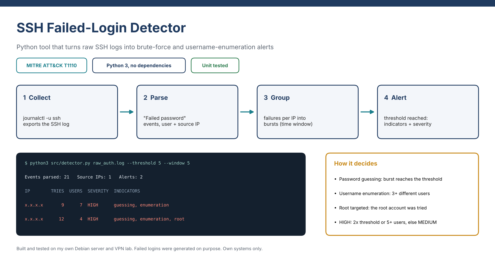

# SSH Failed-Login Detector

A small Python tool that reads OpenSSH logs, groups failed logins into bursts per source IP, and flags likely **brute-force** and **username-enumeration** activity.

Maps to MITRE ATT&CK **T1110 – Brute Force**. Built as a cybersecurity learning project.


## How it works
1. Reads `Failed password` events from `journalctl` or syslog output (journalctl default and `short-iso` timestamps are both supported).
2. Groups the failures per source IP into **bursts**: failures separated by less than `--window` minutes belong to the same burst.
3. Raises an alert when a burst reaches `--threshold` failed attempts, then adds indicators:
   - `password guessing`: the burst reached the threshold.
   - `username enumeration`: 3 or more distinct usernames tried.
   - `root targeted`: the `root` account was attempted.
4. Severity is **HIGH** when attempts reach 2x the threshold or 5+ usernames are tried, otherwise **MEDIUM**.

## Usage
Requires Python 3.8+ and no external packages.

```bash
# Export the SSH log from a Debian server (journald)
sudo journalctl -u ssh --no-pager --since "7 days ago" > raw_auth.log

# Run the detector
python3 src/detector.py raw_auth.log --threshold 5 --window 5 --csv alerts.csv

# Try it with the included sample
python3 src/detector.py sample_logs/sample.log --year 2026
```

| Option | Default | Meaning |
|---|---|---|
| `--threshold` | 5 | Failed attempts in a burst needed to raise an alert |
| `--window` | 5 | Minutes of silence that end a burst |
| `--year` | current year | Year to use when the log has none (journalctl default) |
| `--csv` | none | Also write alerts to a CSV file |

## Sample output
```
SSH failed-login report
Events parsed: 21   Source IPs: 1   Alerts: 2

IP              START               END                 TRIES USERS  SEVERITY INDICATORS
----------------------------------------------------------------------------------------
10.8.0.2        2026-10-06 16:09:30 2026-10-06 16:13:25     9     7  HIGH     password guessing, username enumeration
10.8.0.2        2026-10-06 16:22:46 2026-10-06 16:25:37    12     4  HIGH     password guessing, username enumeration, root targeted
```

## Lab context and data
- Logs come from my own Debian server running OpenSSH and OpenVPN in a home lab. I generated the failed logins on purpose from my own VPN client, using non-existent usernames, `root`, and wrong passwords.
- `sample_logs/sample.log` is an anonymised extract (real usernames replaced). Raw logs are excluded by `.gitignore` so IPs and usernames are never published.
- Use this tool only on systems you own or have permission to monitor.

## Tests
```bash
python3 -m unittest discover -s tests -v
```

## Limitations and next steps
- Only SSH password failures are detected (not key-based failures or successful logins after many failures).
- Bursts are grouped by gaps, not a true sliding window.
- Ideas: detect a successful login after a burst, add GeoIP and allowlists, parse OpenVPN logs, send alerts by email.

## License
MIT. See `LICENSE`.
